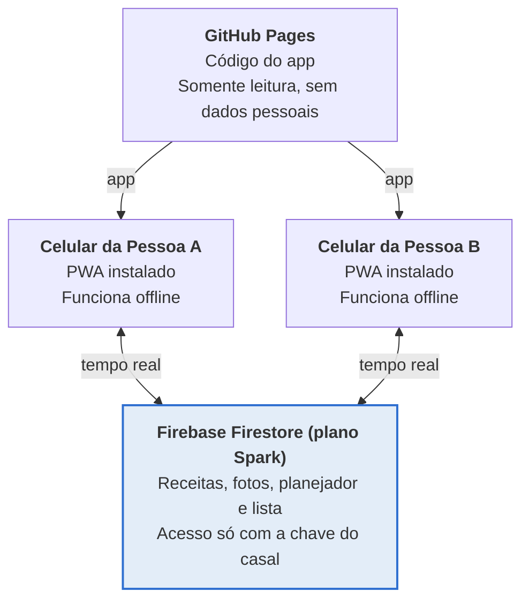
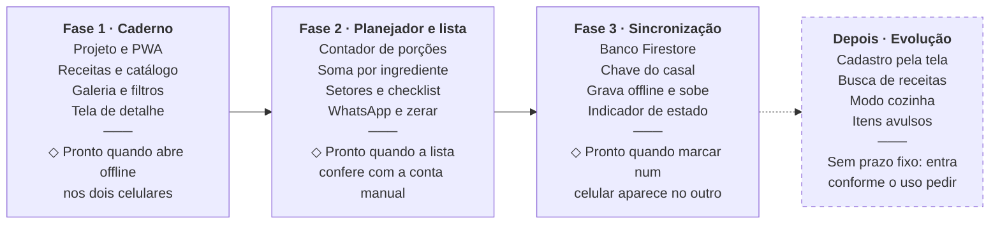

# Caderno de Preparos: Visão de Produto e Requisitos

Oct 18, 2026 · Pessoa A

O Caderno de Preparos é um app web instalável (PWA), gratuito e privado, que ajuda um casal a escolher o que preparar nos próximos 15 dias, gerar uma lista de compras consolidada por setor do supermercado e executar os preparos na cozinha.

## 1. Visão do produto

**Problema.** Cozinhar uma vez e montar refeições a semana toda exige decidir o que fazer, calcular quanto comprar sem repetir itens e consultar receitas com as mãos ocupadas. Hoje isso se espalha entre papel, notas e memória.

**Objetivo.** Reduzir o esforço de planejar, comprar e executar o loteamento de preparos, com uma interface visual que os dois usam no celular.

**Princípios**

- Foco na execução física dos preparos, não em agenda ou horários.
- Visual primeiro: cards com foto, cores por categoria, poucos blocos de texto corrido.
- Custo zero para sempre: nenhuma assinatura, nenhum plano que pode ser bloqueado.
- Dois aparelhos, mesmos dados: o que um marca no mercado o outro vê.
- Simples de manter: as receitas vivem no banco e mudam sem republicar o app; um JSON de carga inicial no repositório serve de ponto de partida e de cópia de segurança.

**O que o produto não é**

- Não é um planner de refeições com calendário e horários.
- Não guarda histórico de compras ou de cardápios passados.
- Não tem contas, login ou divulgação pública.
- Não é um app de receitas aberto a terceiros: é o caderno do casal.

## 2. Usuários e cenários de uso

Haverá dois usuários, o casal, com os mesmos poderes de uso. Um deles (a Pessoa A) cuida do cadastro das receitas.

| Cenário | Onde | O que a pessoa faz | Telas principais |
| --- | --- | --- | --- |
| 1. Definir o cardápio | Sofá, domingo, os dois juntos | Navega pelo Caderno, escolhe receitas para os próximos 15 dias e ajusta porções com + e − | Caderno, Planejador |
| 2. Ir ao mercado | Corredor do supermercado, um dos dois, celular | Abre a lista por setor, marca os itens no carrinho, compartilha o que falta pelo WhatsApp | Lista de Compras |
| 3. Cozinhar o lote | Cozinha, mãos ocupadas | Abre a receita do dia, vê ingredientes por porção e passo a passo com letra grande | Card de receita |

**Critérios de sucesso por cenário**

- Cenário 1: o casal fecha um cardápio de 15 dias em até 15 minutos.
- Cenário 2: a lista aparece já agrupada por corredor e cada marcação aparece no outro celular em até 5 segundos, com internet.
- Cenário 3: a receita abre em 2 toques a partir da tela inicial e é legível a 60 cm de distância.

## 3. Escopo

A versão 1 entrega três módulos (Caderno, Planejador, Lista de Compras) mais a sincronização entre dois aparelhos. Edição de receitas pela interface fica para depois.

| Item | Versão 1 | Depois |
| --- | --- | --- |
| Galeria de cards com foto e filtro por categoria | Sim |  |
| Ingredientes por porção e setor do mercado em cada receita | Sim |  |
| Planejador com contador de porções (+ e −) | Sim |  |
| Lista de compras consolidada, por setor, com checklist | Sim |  |
| Compartilhar a lista no WhatsApp como texto | Sim |  |
| Botões para zerar planejador e lista | Sim |  |
| Sincronização do planejador e da lista entre dois aparelhos | Sim |  |
| PWA instalável com uso offline do caderno | Sim |  |
| Receitas guardadas no banco, carregadas na primeira vez por um arquivo inicial | Sim |  |
| Criar, editar e excluir receitas pela interface (CRUD) |  | Sim (entregue) |
| Histórico de compras ou de cardápios | Não previsto |  |
| Login, contas, divulgação pública | Não previsto |  |
| Agenda, calendário, horários de refeição | Não previsto |  |

## 4. Requisitos funcionais

Cada requisito tem um código (RF) para facilitar a conversa e os testes. Prioridade: M = essencial na versão 1, D = desejável.

### 4.1 Caderno de Preparos

| Código | Requisito | Prior. |
| --- | --- | --- |
| RF-01 | Exibir as receitas em galeria de cards, cada um com foto de capa (ou o ícone da categoria enquanto não houver foto), nome, categoria (tag colorida), tempo e rendimento. | M |
| RF-02 | Filtrar por categoria com abas ou chips no topo: Proteínas, Bases/Grãos/Tubérculos, Legumes e Acompanhamentos, Molhos e Temperos Base, Lanches Rápidos, Sucos e Bebidas. Uma categoria por vez ou "Todas". | M |
| RF-03 | Buscar receita por nome ou ingrediente. | D |
| RF-04 | Abrir o card em tela de detalhe com: foto, rendimento, tempo, conservação, ingredientes (quantidade por porção individual e setor do supermercado de cada um) e passo a passo numerado. | M |
| RF-05 | No detalhe, permitir ver a receita para um número de porções escolhido, sem alterar o planejador. | D |
| RF-06 | Modo cozinha: letra grande, tela que não apaga enquanto a receita está aberta e passos que podem ser marcados como feitos. | D |
| RF-07 | Botão "Adicionar ao planejador" dentro do card e do detalhe. | M |

### 4.2 Planejador

| Código | Requisito | Prior. |
| --- | --- | --- |
| RF-10 | Mostrar só as receitas escolhidas, na ordem das categorias, com filtro só pelas categorias que têm receita escolhida; tocar numa delas abre o detalhe. A escolha é feita no Caderno (RF-07). | M |
| RF-11 | Selecionar e desselecionar uma receita com um toque, pelo botão do card no Caderno. No Planejador, tirar a última porção tira a receita (RN-06). | M |
| RF-12 | Cada receita selecionada exibe um contador numérico com + e − para as porções desejadas (mínimo 1, valor inicial = rendimento padrão da receita). | M |
| RF-13 | Exibir um resumo fixo no rodapé: quantas receitas e quantas porções no total, ou na categoria filtrada. | M |
| RF-14 | Botão "Zerar planejador" com confirmação antes de apagar. | M |
| RF-15 | A lista de compras se recalcula sozinha sempre que o planejador muda; não há botão para gerá-la. | M |

### 4.3 Lista de Compras

| Código | Requisito | Prior. |
| --- | --- | --- |
| RF-20 | Calcular a lista multiplicando a quantidade por porção de cada ingrediente pelas porções escolhidas (regras na seção 5). | M |
| RF-21 | Somar o mesmo ingrediente vindo de receitas diferentes em uma única linha, convertendo unidades compatíveis (ex.: 800 g + 600 g = 1,4 kg). | M |
| RF-22 | Agrupar a lista automaticamente por setor: Açougue e Peixaria, Hortifrúti, Mercearia e Grãos, Frios e Laticínios, Temperos e Diversos. | M |
| RF-23 | Cada linha tem caixa de seleção (checkbox); itens marcados ficam riscados e vão para o fim do setor. | M |
| RF-24 | Mostrar progresso por setor e geral (ex.: 7 de 23 itens). | D |
| RF-25 | Compartilhar a lista pelo WhatsApp como texto, com setores, itens e quantidades; por padrão só os itens não marcados. | M |
| RF-26 | Botão "Zerar" na lista, com confirmação, igual ao do planejador: apaga receitas, porções e marcações. | M |
| RF-27 | Permitir adicionar um item avulso à lista (ex.: papel toalha) que não vem de receita, num dos setores ou no grupo Outros. | D |
| RF-28 | Mostrar de quais receitas vem cada item, e quanto cada uma pede, pela seta ao lado dele (tocar no item continua marcando). | D |

### 4.4 Sincronização e persistência

| Código | Requisito | Prior. |
| --- | --- | --- |
| RF-30 | O planejador, as porções, as marcações da lista e os itens avulsos são sincronizados entre os dois aparelhos. | M |
| RF-31 | As receitas e o catálogo de ingredientes ficam no banco e são lidos pelos dois aparelhos; uma mudança nas receitas aparece nos dois e o caderno continua disponível offline depois do primeiro carregamento. | M |
| RF-32 | O app abre e mostra o último estado salvo mesmo sem internet; as alterações feitas offline sobem quando a conexão voltar. | M |
| RF-33 | Indicador discreto de estado: sincronizado, sincronizando ou offline. | D |
| RF-34 | Não há histórico: apenas o estado atual do planejador e da lista é guardado. | M |

### 4.5 Instalação e navegação

| Código | Requisito | Prior. |
| --- | --- | --- |
| RF-40 | Instalável na tela inicial do celular como app (PWA), com ícone e nome próprios. | M |
| RF-41 | Navegação por barra inferior com três destinos: Caderno, Planejador, Lista. | M |
| RF-42 | Funciona em celular e computador (layout responsivo). | M |

## 5. Regras de negócio

A regra central: a lista de compras é sempre calculada a partir do planejador, nunca digitada. Toda receita guarda a quantidade por **uma** porção; o sistema multiplica.

**RN-01 Cálculo.** Quantidade na lista = soma, para todas as receitas selecionadas, de (quantidade por porção × porções escolhidas).

```latex
Q_{item} = \sum_{r \in receitas} q_{r,item} \times p_r
```

**RN-02 Mesmo ingrediente, mesma linha.** Dois ingredientes são o mesmo item quando têm o mesmo código de ingrediente (ex.: `carne-moida`), não o mesmo texto. Por isso o catálogo de ingredientes é separado das receitas: "patinho", "Patinho moído" e "carne moída (patinho)" apontam para um único código.

**RN-03 Unidades.** Cada ingrediente tem uma unidade base única (g, ml ou unidade). As receitas informam a quantidade na unidade base; a tela converte para exibir:

| Unidade base | Exibição abaixo do limite | Exibição a partir do limite |
| --- | --- | --- |
| g | em g (ex.: 800 g) | em kg a partir de 1000 g (ex.: 1,4 kg) |
| ml | em ml (ex.: 250 ml) | em L a partir de 1000 ml |
| unidade | em unidades (ex.: 3 ovos) | sem conversão |

Medidas caseiras (colher, xícara) entram no catálogo com um fator de conversão para a unidade base (ex.: 1 colher de sopa de azeite = 13 ml) para poderem ser somadas.

**RN-04 Arredondamento.** Pesos e volumes arredondam para cima em múltiplos úteis (g para o múltiplo de 5, ml para o de 10). Itens contados (ovos, limões) arredondam para a unidade inteira acima. A lista mostra o valor calculado, e o arredondamento nunca fica abaixo do necessário.

**RN-05 Setor do supermercado.** Cada ingrediente do catálogo tem um único setor: Açougue e Peixaria, Hortifrúti, Mercearia e Grãos, Frios e Laticínios ou Temperos e Diversos. O setor pertence ao ingrediente, não à receita, para que o mesmo item caia sempre no mesmo corredor.

**RN-06 Porções.** O contador começa no rendimento padrão da receita e aceita inteiros de 1 a 99. Uma receita com 0 porções sai do planejador.

**RN-07 Marcações x recálculo.** Se o planejador mudar depois de marcar itens na lista, as marcações dos itens que continuam na lista são mantidas. Se a quantidade de um item marcado aumentar, o item volta a ficar desmarcado, para não esquecer a diferença. Para isso, cada marcação guarda a quantidade que o item tinha na lista no momento em que foi marcado.

**RN-08 Zerar.** O botão "Zerar" faz a mesma coisa no Planejador e na Lista: apaga seleções, porções, marcações e itens avulsos. Como a lista é derivada do planejador, ela fica vazia.

**RN-09 Texto do WhatsApp.** Formato de exemplo:

```markdown
*Lista de compras*

*Açougue e Peixaria*
- Patinho moído: 1,4 kg
- Peito de frango: 800 g

*Hortifrúti*
- Cenoura: 600 g
- Limão: 4 unidades
```

**RN-10 Itens de despensa.** Ingredientes marcados como `basico` no catálogo (sal, pimenta) não entram no setor deles: vão para um grupo final da lista, "Confira na despensa". Mostram a quantidade somada quando alguma receita informa e "a gosto" quando nenhuma informa (ex.: "Sal: 10 g + a gosto").

## 6. Requisitos não funcionais

| Código | Categoria | Requisito |
| --- | --- | --- |
| RNF-01 | Custo | Nenhum componente com cobrança ou cartão de crédito obrigatório. Hospedagem e sincronização ficam em planos gratuitos que não exigem upgrade para o uso de duas pessoas. |
| RNF-02 | Disponibilidade | O caderno precisa abrir mesmo se o serviço de sincronização estiver fora do ar ou pausado. |
| RNF-03 | Offline | Depois do primeiro acesso, o app abre sem internet (service worker com cache do código; receitas e fotos no cache do Firestore). |
| RNF-04 | Desempenho | Primeira tela em até 2 s em 4G; a lista recalcula em até 100 ms após mudar uma porção. Fotos reduzidas no aparelho antes de gravar (WebP, ou JPEG no iPhone; até 100 KB cada). |
| RNF-05 | Responsivo | Projetado primeiro para celular (360 a 430 px de largura), com ajuste para tablet e computador. |
| RNF-06 | Usabilidade | Alvos de toque de pelo menos 44 px; contraste de texto mínimo 4,5:1; fonte do corpo a partir de 16 px; áreas de toque das caixas de seleção grandes o bastante para uso com uma mão. |
| RNF-07 | Privacidade | Sem login, mas sem endereço público divulgado. Os dados sincronizados ficam sob um identificador longo e aleatório que só o casal conhece (ver seção 7). Nenhum rastreador, anúncio ou análise de terceiros. |
| RNF-08 | Manutenção | Receitas e ingredientes no banco, editáveis pela tela do app sem republicá-lo. Um arquivo JSON de carga inicial no repositório popula o banco quando o código do casal é criado; depois disso, Ajustes baixa uma cópia de segurança no mesmo formato. Fotos enviadas pelo app e guardadas no banco. |
| RNF-09 | Portabilidade | Sem depender de um único fornecedor: o código é estático e pode ser movido para outra hospedagem gratuita; a sincronização fica atrás de uma camada fina que pode trocar de serviço. |
| RNF-10 | Compatibilidade | Chrome e Safari recentes no Android e no iPhone; Chrome, Edge e Safari no computador. |
| RNF-11 | Idioma | Português do Brasil, unidades métricas, vírgula decimal. |

## 7. Arquitetura e sincronização gratuita

A proposta é um site estático no GitHub Pages para o app, mais um banco gratuito na nuvem que guarda as receitas, as fotos, o planejador e a lista, iguais nos dois aparelhos. Como o GitHub Pages não executa código de servidor, ele sozinho não consegue sincronizar nada; é a peça de banco que resolve o requisito de sincronização.

**O app vem do GitHub Pages; receitas e lista vivem no Firestore**



*arquitetura · 2 celulares, 1 hospedagem, 1 banco*

Os dois celulares baixam o app do GitHub Pages e leem e gravam receitas, fotos, planejador e lista no Firestore.

**Hospedagem do app.** GitHub Pages. Atenção: em conta gratuita, o Pages publica a partir de repositório público. Isso torna o código visível por quem souber o endereço, o que não tem problema, mas obriga a **nunca** colocar chaves ou senhas no repositório.

**Opções de sincronização avaliadas**

| Opção | Custo | Tempo real | Offline | Risco para este projeto |
| --- | --- | --- | --- | --- |
| Firebase Firestore (plano Spark) | Gratuito, sem cartão | Sim | Sim, nativo no SDK web | Cota gratuita muito acima do uso de 2 pessoas; exige conta Google |
| Supabase (plano Free) | Gratuito | Sim | Precisa de código extra | Projetos gratuitos são pausados após período sem uso, o que fere RNF-02 |
| Cloudflare Workers + KV/D1 | Gratuito | Não nativo | Precisa de código extra | Mais código de servidor para escrever e manter |
| Google Sheets + Apps Script | Gratuito | Não | Precisa de código extra | Latência alta e limites de execução; gambiarra para uma lista que muda no mercado |
| Arquivo no GitHub gravado pelo app | Gratuito | Não | Não | Exigiria um token de escrita dentro do app público |

**Recomendação: Firebase Firestore no plano Spark.** Ele entrega tempo real e funcionamento offline sem código de servidor, e o plano Spark não pede cartão. Os limites e as regras do plano devem ser conferidos no console do Firebase na hora de criar o projeto, porque mudam com o tempo. O fallback é trocar a camada de sincronização (RNF-09) sem mexer no resto do app.

**Como funciona sem login**

- No primeiro uso, o app cria uma chave longa e aleatória (o "código do casal"). Ela vira o endereço do documento no banco e fica guardada no aparelho.
- O segundo aparelho recebe a chave uma única vez, por um link ou QR code gerado na tela de Ajustes, e passa a ler e gravar o mesmo documento.
- As regras de segurança do banco permitem ler e gravar um documento conhecido pelo caminho, e proibem listar ou procurar outros. Sem a chave, não há como encontrar os dados.
- A chave nunca entra no repositório do código.
- Se a chave vazar, Ajustes → Trocar código gera uma chave nova com todos os dados, esvazia o espaço antigo e o marca como trocado.

**Como evitar conflitos entre os dois celulares**

- O planejador é guardado como um mapa receita → porções, e a lista como um mapa item → marcado ou não. Cada toque grava só o campo alterado, não o documento inteiro.
- Em caso de edição simultânea do mesmo campo, vale a última gravação. Para uma lista de compras de duas pessoas, é suficiente.
- A lista não é gravada: ela é recalculada a partir do planejador em cada aparelho (RN-01). Só as marcações e os itens avulsos vão para o banco.

## 8. Modelo de dados

Todos os dados moram no banco, dentro do espaço do casal: o catálogo de ingredientes e as receitas (mudam pouco) e o estado do planejador e da lista (mudam toda hora). Um arquivo JSON de carga inicial, guardado no repositório, popula o banco na primeira vez e serve de cópia de segurança. Os exemplos abaixo são trechos da carga inicial ([src/dados/carga-inicial.json](../src/dados/carga-inicial.json)). A carga também traz as listas de categorias e setores, que precisam usar os mesmos códigos do app, e as premissas usadas para converter as receitas originais.

**Catálogo de ingredientes (`coleção ingredientes`)** – cada ingrediente existe uma só vez, com unidade base e setor. `medidas` guarda o fator de cada medida caseira na unidade base (RN-03); `basico` marca itens de despensa, como sal e pimenta.

```json
{
  "carne-moida": { "nome": "Carne moída magra (patinho)", "unidade": "g",  "setor": "acougue", "medidas": {} },
  "azeite":      { "nome": "Azeite",                      "unidade": "ml", "setor": "mercearia", "medidas": { "cs": 13, "cc": 4 } },
  "sal":         { "nome": "Sal",                         "unidade": "g",  "setor": "temperos", "medidas": { "cc": 6, "cs": 18 }, "basico": true }
}
```

**Receita (`coleção receitas`)** – `ingredientes` traz as quantidades por **uma** porção, na unidade base, para calcular a lista. Itens sem quantidade na receita original ficam com `aGosto: true` e `qtdPorPorcao: null`. `ingredientesTexto` guarda a receita inteira como foi escrita, para consulta na cozinha. `fonte`, opcional, guarda o link do post ou de onde veio a receita; o detalhe mostra como link.

```json
{
  "id": "almondegas-assadas",
  "nome": "Almôndegas assadas",
  "categoria": "proteinas",
  "tags": [],
  "foto": null,
  "porcoesPadrao": 8,
  "descricaoPorcao": "3 almôndegas",
  "rendimentoOriginal": "24 unidades",
  "tempo": "35 min",
  "conservacao": { "Geladeira": "3 a 4 dias", "Freezer": "3 meses" },
  "ingredientes": [
    { "ingrediente": "carne-moida", "qtdPorPorcao": 62.5 },
    { "ingrediente": "ovo", "qtdPorPorcao": 0.125 },
    { "ingrediente": "sal", "qtdPorPorcao": null, "aGosto": true }
  ],
  "ingredientesTexto": ["500 g de carne moída magra", "1 ovo e ¼ de xícara de aveia em flocos finos"],
  "passos": ["Misture tudo e modele bolinhas de 3 cm.", "Asse a 200 °C por 18 a 20 minutos, virando na metade."],
  "vira": "Macarrão com molho de tomate, marmita com arroz e legumes, pão sírio."
}
```

**Fotos (`coleção fotos`, uma por receita, com o código da receita)** – a imagem reduzida no aparelho, em bytes, com o tipo (`image/webp` ou `image/jpeg`). As regras do banco recusam arquivos acima de 200 KB.

**Estado sincronizado (banco, um documento por casal)** – `planejador` guarda receita → porções; `marcados` guarda ingrediente → quantidade na lista quando foi marcado (RN-07); `avulsos` guarda os itens que não vêm de receita (RF-27), num mapa para que cada toque grave só o item alterado.

```json
{
  "planejador": { "almondegas-assadas": 8, "arroz-integral": 6 },
  "marcados":   { "carne-moida": 1065 },
  "avulsos":    { "a1": { "nome": "Papel toalha", "setor": "temperos", "marcado": false } }
}
```

**Categorias e setores (listas fixas)**

| Tipo | Valores |
| --- | --- |
| Categorias de receita | Proteínas, Bases/Grãos/Tubérculos, Legumes e Acompanhamentos, Molhos e Temperos Base, Lanches Rápidos, Sucos e Bebidas |
| Setores do supermercado | Açougue e Peixaria, Hortifrúti, Mercearia e Grãos, Frios e Laticínios, Temperos e Diversos |

## 9. Design e identidade visual

O app reaproveita a paleta da página visual e da apresentação já criadas: uma cor por categoria, fundo claro esverdeado e verde-escuro para a navegação.

| Papel | Cor | Hex |
| --- | --- | --- |
| Proteínas | Vermelho tijolo | #B3372B |
| Bases, Grãos e Tubérculos | Dourado escuro | #8C6A0A |
| Legumes e Acompanhamentos | Verde | #2E7A40 |
| Molhos e Temperos Base | Laranja queimado | #BF5A0D |
| Lanches Rápidos | Verde-azulado | #1F7A7A |
| Sucos e Bebidas | Magenta | #A23B72 |
| Navegação e botões de ação | Verde-escuro | #2A3A30 |
| Texto | Quase preto esverdeado | #1D2620 |
| Fundo | Verde-gelo | #F1F4EE |

**Tipografia.** A página visual usou Bricolage Grotesque (títulos) e Figtree (texto); a apresentação usou Montserrat e Lato. No app, sugiro um único par; as fontes ficam dentro do repositório para funcionar offline.

**Componentes principais**

- Card de receita: foto de capa em 4:3, tag colorida da categoria, nome, tempo e rendimento; botão redondo "+" para adicionar ao planejador.
- Chips de filtro por categoria, rolláveis na horizontal, na cor da categoria.
- Contador de porções com botões − e + grandes e o número no meio.
- Linha de lista com caixa de seleção grande, nome, quantidade à direita; riscada quando marcada.
- Cabeçalho de setor com cor, ícone e contagem de itens restantes.
- Barra inferior fixa com Caderno, Planejador e Lista, mais selo com o número de itens pendentes na Lista.
- Botões de ação: Zerar, com confirmação, no Planejador e na Lista; Compartilhar no WhatsApp (verde próprio do WhatsApp apenas nesse botão).

**Fotos.** Sem foto, o card mostra o ícone da categoria sobre um fundo na cor dela. A foto é escolhida no formulário da receita (câmera ou galeria), reduzida no próprio aparelho para até 100 KB e gravada no Firestore, numa coleção separada das receitas, para os dois celulares verem e para funcionar offline. Não usa o Firebase Storage, que hoje exige o plano pago, nem a pasta do repositório, que exigiria uma senha de escrita do GitHub dentro do app público (decisão de 18/10/2026).

**Interatividade esperada.** Animações curtas ao adicionar uma receita, ao mudar o contador e ao marcar um item; filtro e busca que respondem enquanto se digita; resumo fixo com totais que se atualiza na hora.

## 10. Riscos e pontos em aberto

Os cinco pontos em aberto foram decididos em 18/10/2026; a tabela registra a decisão e o que ela muda.

| # | Ponto | Decisão | O que muda no projeto |
| --- | --- | --- | --- |
| 1 | Categoria Café da manhã | Vira parte de Lanches Rápidos | Ficam seis categorias; as receitas de café da manhã entram em Lanches |
| 2 | Conta Google para o Firebase | Usar a conta Gmail da Pessoa A | É o único cadastro; sem cartão no plano Spark |
| 3 | Repositório público | Aceito, sem divulgação | Nome discreto; nenhuma chave no código |
| 4 | Fotos | Começar com ícones por categoria e adicionar fotos depois | Fotos enviadas pelo app e guardadas no Firestore, reduzidas no aparelho (revisto em 18/10/2026; antes previstas numa pasta do repositório) |
| 5 | Onde ficam as receitas | No banco, não no código | Editar receitas não exige republicar o app e facilita o cadastro pela tela (CRUD) no futuro |

**Riscos técnicos**

- Limites e regras do plano gratuito do Firebase podem mudar. Mitigação: camada de sincronização isolada (RNF-09) e uso muito abaixo das cotas.
- iPhone e PWA: o Safari instala o app pelo botão Compartilhar, e o armazenamento local pode ser limpo se o app ficar muito tempo sem uso. Mitigação: os dados importantes ficam no banco, e o app reidrata ao abrir.
- Soma de ingredientes depende de um catálogo limpo (RN-02). Um nome digitado diferente numa receita nova gera duas linhas. Mitigação: o app valida receitas contra o catálogo e avisa de códigos desconhecidos.
- Medidas caseiras (colher, xícara, dente de alho) precisam de fatores de conversão razoáveis; pequenas diferenças são aceitáveis, mas devem ficar visíveis no catálogo.
- Sem login, quem receber o link com a chave acessa os dados. Mitigação: não postar a chave; se ela vazar, Ajustes → Trocar código copia tudo para um código novo e esvazia o antigo, que passa a avisar o outro celular de que foi trocado.

## 11. Roadmap sugerido

Cada fase termina num critério de pronto verificável, para você testar antes de seguir. A fase 1 já é útil sozinha como caderno.

**Três fases entregam o app; a evolução vem depois**



| Fase | Entrega | Pronto quando |
| --- | --- | --- |
| 1. Caderno | Projeto e PWA; receitas e catálogo; galeria e filtros; tela de detalhe | O app abre offline nos dois celulares |
| 2. Planejador e lista | Contador de porções; soma por ingrediente; setores e checklist; WhatsApp e zerar | A lista confere com a conta feita à mão |
| 3. Sincronização | Banco Firestore; chave do casal; grava offline e sobe; indicador de estado | Marcar um item num celular aparece no outro |
| Depois. Evolução | Cadastro pela tela; busca de receitas; modo cozinha; itens avulsos | Sem prazo fixo: entra conforme o uso pedir |

*roadmap · 3 fases com critério de pronto e uma etapa de evolução*

Os desejáveis marcados com D na seção 4 entram na etapa Depois, na ordem que o uso pedir. Cadastro de receitas pela tela (CRUD) pode ser a primeira evolução.

**Andamento.** As fases 1 a 3 foram validadas nos dois celulares em 18/10/2026. Da etapa Depois já entraram o cadastro de receitas e ingredientes pela tela, a busca (RF-03), as porções no detalhe (RF-05, também no modo cozinha), o modo cozinha (RF-06), os itens avulsos (RF-27), a origem de cada item (RF-28) a troca do código do casal e as fotos das receitas enviadas pelo app. Com o cadastro pela tela, o banco passou a ser a fonte das receitas: a carga inicial só é usada na criação do código do casal.
